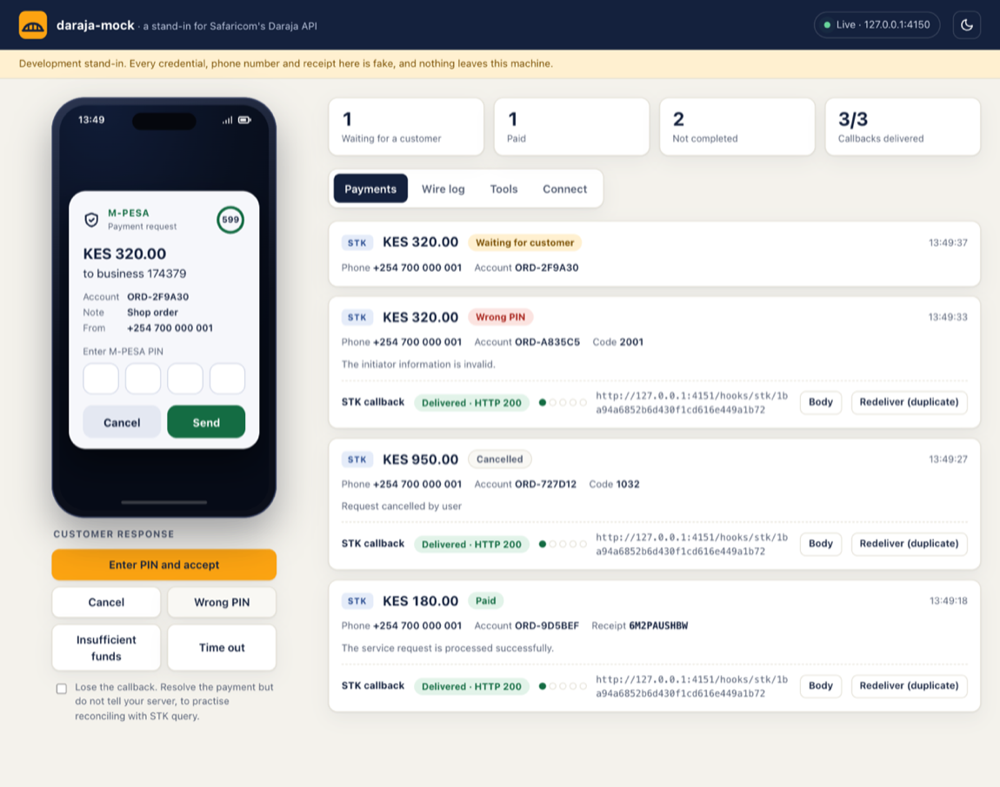
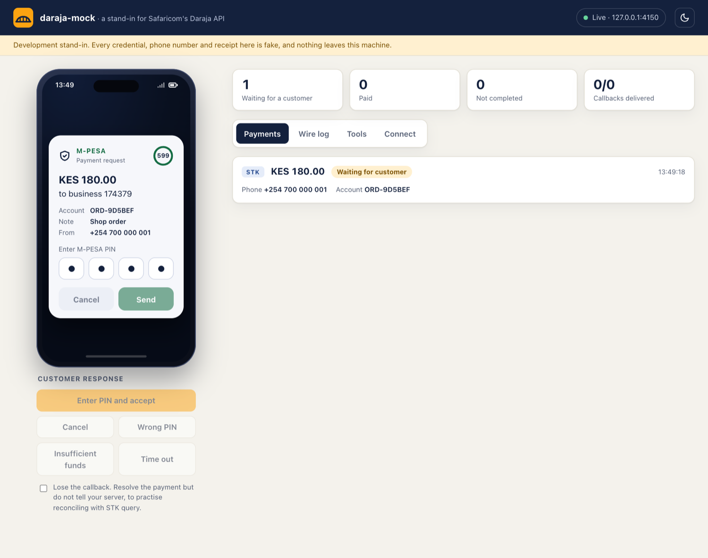
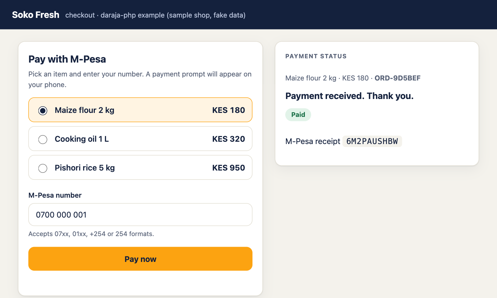
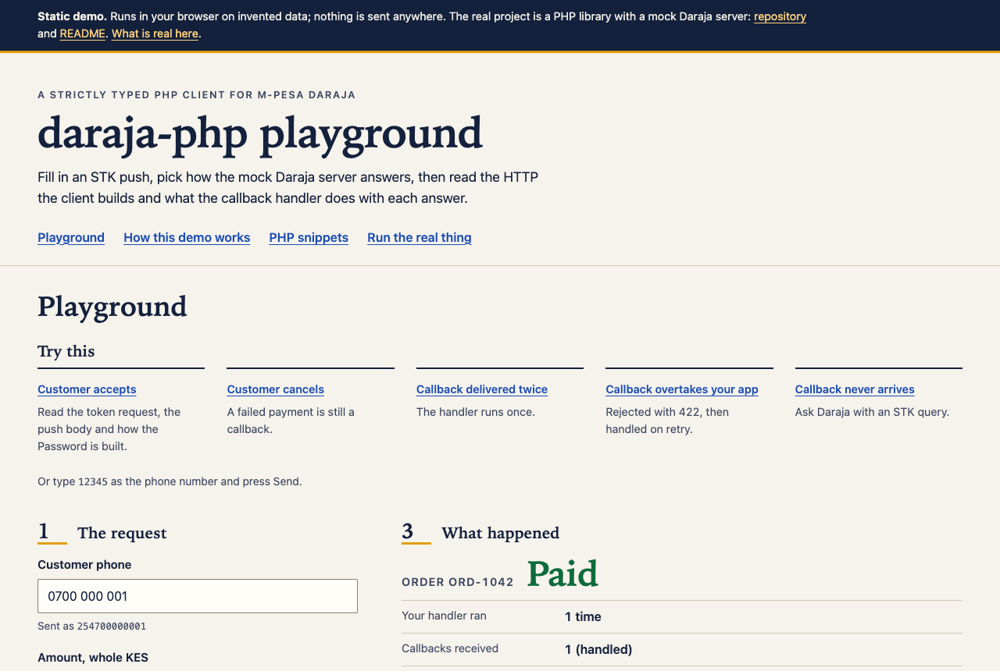
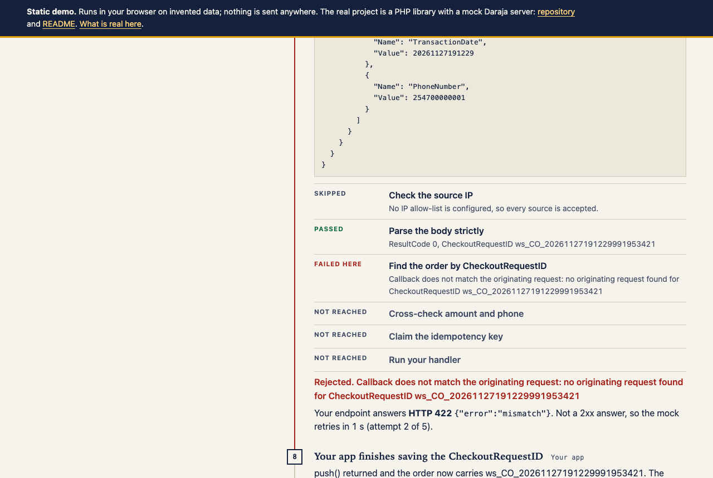
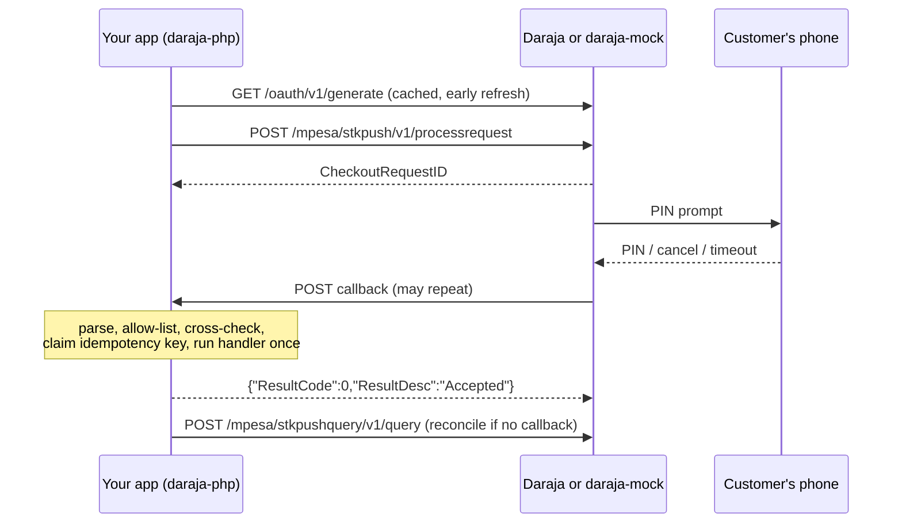

<div align="center">

# daraja-php

**A strictly-typed PHP client for Safaricom's M-Pesa Daraja API, with a built-in mock Daraja server so you can build and test payment flows with no credentials and no internet.**

[](https://github.com/Victor-Wambua/daraja-php/actions/workflows/ci.yml)
[](LICENSE)


**[Live demo: try an STK push in your browser](https://victor-wambua.github.io/daraja-php/)**



</div>

> **Status: portfolio build.** It runs locally against its own mock server with synthetic data.
> It has **never been run against Safaricom's live or sandbox API**. See [what is unverified](#status-and-roadmap).

## The problem

Most Kenyan PHP shops end up with the same fragile M-Pesa code: a cURL snippet that fetches a new OAuth token
on every request, a hand-built timestamp and password, a callback endpoint that trusts whatever JSON arrives,
and no answer for "Safaricom sent the same callback twice". The last one is how a customer gets credited twice.
You also cannot test any of it without sandbox credentials and a public HTTPS URL for the callback.

## What it does

- **Typed Daraja client.** OAuth token with PSR-16 caching and an expiry safety margin, **STK Push** and STK query,
  **C2B** register-URLs and validation/confirmation parsing, **B2C**, **Transaction Status** and **Reversal**.
  Plain PHP 8.3, `strict_types`, readonly value objects, enums for result codes, immutable config.
- **Correct by construction.** Phone numbers (`07xx`, `01xx`, `+254`, `254`) normalise to `2547XXXXXXXX`/`2541XXXXXXXX`
  or are rejected. Amounts are whole shillings (and integer cents internally, never floats). The password and
  the East Africa Time timestamp are built for you.
- **Callback safety.** One `CallbackProcessor` does a strict payload check, an optional source-IP allow-list, a
  cross-check of amount and phone against your order, and an **idempotency store** (in-memory and PDO/SQLite)
  so a retried callback never runs your handler twice.
- **Mock Daraja server.** `bin/daraja-mock` serves the same routes and JSON shapes, plus a web console with a
  simulated phone. Press **Accept / Cancel / Wrong PIN / Insufficient funds / Time out** and the mock POSTs the
  right callback to your app, with retries. You can also withhold the callback to practise reconciliation, and
  redeliver one to prove your endpoint survives duplicates.
- **Two example apps.** A tested plain-PHP shop, and a clearly-labelled set of Laravel snippets (not run).

<p align="center">
  
  
</p>

## Live demo

[victor-wambua.github.io/daraja-php](https://victor-wambua.github.io/daraja-php/) is an interactive explainer: fill in an STK push, pick how the mock
answers (accept, cancel, no funds, timeout, callback twice, out of order, lost), and read the exact HTTP the client builds and what `CallbackProcessor` does.

- **The PHP library is not running in the page.** The demo is a JavaScript port of the pure parts (validation, request building, password and
  timestamp, token cache, strict callback parser, idempotency store, cross-check) and of the mock's OAuth, STK and callback behaviour. Nothing is sent anywhere.
- **The port is tested against the real code.** `demo/tools/golden.php` runs inputs through the real library, including the real client against the
  real mock in process, and `demo/test/golden.json` holds the answers. CI fails if the port or the PHP code drifts. The PHP snippets on the page are cut verbatim from `examples/`, and CI re-cuts them.
- **Not ported:** C2B, B2C, Transaction Status, Reversal, the IP allow-list, the SQLite store and the mock's own console. Three scenarios (callback overtakes your app, stale cancel, changed amount) are injected by the demo; the mock cannot produce them.
- Develop it with `cd demo && npm test`, `npm run smoke` (Playwright), `npm run golden` and `npm run snippets`. There is no build step.

<p align="center">
  
  
</p>

## Quick start

Needs PHP 8.3+ with `curl` and `pdo_sqlite`, and Composer. No network access beyond `composer install`.

```bash
git clone https://github.com/Victor-Wambua/daraja-php.git
cd daraja-php
composer install

bin/daraja-mock                                       # terminal 1: console at http://127.0.0.1:4150
php -S 127.0.0.1:4151 -t examples/plain-php/public    # terminal 2: example shop at http://127.0.0.1:4151
```

Open the shop, press **Pay now**, then answer the prompt on the phone in the console. The shop updates by itself.
Try the other buttons, tick **Lose the callback**, or press **Redeliver (duplicate)** and check the order is credited once.

Using the library in your own code:

```php
use Daraja\Config\DarajaConfig;
use Daraja\Daraja;
use Daraja\Stk\StkPushRequest;

// DARAJA_BASE_URL=http://127.0.0.1:4150 points this at the mock; leave it unset for Safaricom's sandbox.
$daraja = Daraja::create(DarajaConfig::fromEnv(getenv()), cache: $psr16Cache);

$push = $daraja->stk()->push(new StkPushRequest(
    amount: 150,
    phoneNumber: '0700 000 001',          // normalised to 254700000001
    callbackUrl: 'https://shop.example/hooks/stk/<secret>',
    accountReference: 'ORD-1042',
    transactionDesc: 'Shop order',
));
// store $push->checkoutRequestId with the order; the result arrives later by callback
```

And the callback endpoint:

```php
$result = $processor->processStk(
    file_get_contents('php://input'),
    fn (StkCallback $cb) => $orders->apply($cb),                        // runs once per payment
    fn (StkCallback $cb) => $orders->expectedPayment($cb->checkoutRequestId), // null = unknown request, rejected
    $_SERVER['REMOTE_ADDR'] ?? null,
);
echo $result->acknowledgementJson();
```

## How it works



Key decisions (details in the [case study](docs/CASE-STUDY.md)):

- **The mock is a real HTTP server, not a mocked client.** Your code, the cURL client, JSON and callback delivery
  all run for real, so the tests exercise what production exercises.
- **Idempotency has two locks.** The store protects the handler; a `UNIQUE` receipt column in your own ledger
  protects the money. The example and the Laravel snippets use both.
- **Nothing is retried blindly.** Only a 401 triggers one token refresh and one repeat. A timed-out payment
  request is never replayed, because replaying it can charge a customer twice.
- **No Safaricom addresses are hard-coded.** The IP allow-list is empty until you supply the addresses.
- **Unsure details are configurable.** Field length limits and the Reversal identifier type are parameters.

```
src/            Daraja facade, Stk/ C2b/ B2c/ Status/ Reversal/ services, Callback/ typed DTOs and parser,
                Safety/ (idempotency, allow-list, cross-check, processor), Auth/ Http/ Config/ Support/
                Mock/ the mock server (store, scenarios, dispatcher, router, Console/index.html)
bin/daraja-mock supervisor: PHP built-in server + callback dispatcher
examples/       plain-php (tested end to end) and laravel (copy-in snippets, not run)
tests/          Unit/ and Integration/ (boots the real mock + a receiver on localhost)
docs/           CASE-STUDY.md, GOING-LIVE.md, screenshots/
```

## Mock server options

`bin/daraja-mock --help` lists everything. The useful ones:

| Option | Default | Meaning |
| --- | --- | --- |
| `--port` | `4150` | Port to listen on (loopback only unless `--allow-remote`) |
| `--stk-timeout` | `60` | Seconds before an unanswered prompt times out with code 1037 |
| `--retry-delays` | `1,3,10,30` | Seconds between callback retries (a test aid, not a claim about Safaricom) |
| `--token-ttl` | `3599` | OAuth token lifetime, handy for testing refresh |
| `--consumer-key/--consumer-secret/--shortcode/--passkey` | fake values | What the mock accepts |

Routes: `GET /oauth/v1/generate`, `POST /mpesa/stkpush/v1/processrequest`, `/mpesa/stkpushquery/v1/query`,
`/mpesa/c2b/v1|v2/registerurl`, `/mpesa/c2b/v1/simulate`, `/mpesa/b2c/v1/paymentrequest`,
`/mpesa/transactionstatus/v1/query`, `/mpesa/reversal/v1/request`.

## Testing

```bash
composer test      # PHPUnit 11: unit tests plus the localhost integration suite
composer analyse   # PHPStan level max over src, tests and bin
composer lint      # PHP-CS-Fixer (PSR-12 + strict rules), dry run
```

Last full run on PHP 8.4: **279 tests, 752 assertions, all passing** (267 unit, 12 integration), PHPStan level max clean,
code style clean. CI runs the same on PHP 8.3 and 8.4. Nothing in the suite touches the internet.

Covered: phone and amount validation, request bodies and the password/timestamp, token caching, expiry margin,
early refresh and 401 retry-once, error mapping that keeps Daraja codes, every result code mapping, strict callback
parsing (including "success without a receipt is rejected"), idempotency on in-memory and SQLite (including two
connections racing), IP allow-list v4/v6 CIDR, amount/phone cross-checks, the mock's validation and scenarios,
retry scheduling, and a full STK flow over real HTTP: accept, cancel, wrong PIN, insufficient funds, timeout,
retry until the receiver recovers, duplicate delivery credited once, lost callback reconciled by query, C2B.

Fixtures in `tests/Fixtures` are **shaped after Safaricom's public documentation; not recorded from live traffic**.

## Configuration

| Variable | Purpose |
| --- | --- |
| `DARAJA_ENV` | `sandbox` (default) or `production` |
| `DARAJA_BASE_URL` | Override the host, for example the mock. Plain http is only accepted for loopback hosts |
| `DARAJA_CONSUMER_KEY`, `DARAJA_CONSUMER_SECRET` | Your Daraja app credentials |
| `DARAJA_SHORTCODE`, `DARAJA_PASSKEY` | Paybill/store number and Lipa na M-Pesa Online passkey |
| `DARAJA_INITIATOR_NAME`, `DARAJA_SECURITY_CREDENTIAL` | For B2C, Transaction Status, Reversal (see `SecurityCredential`) |
| `DARAJA_CALLBACK_ALLOWED_IPS` | Example app only: comma separated trusted callback sources, from Safaricom |

See [`.env.example`](.env.example) and [`docs/GOING-LIVE.md`](docs/GOING-LIVE.md).

## Status and roadmap

Portfolio build, runs locally with synthetic data. Honest limits:

- **Not verified against live Daraja or its sandbox.** Request and response shapes follow the public documentation.
  Result codes beyond the common ones, exact error codes and messages, field length limits, the C2B URL rules,
  B2C v1 vs v3 and the Reversal identifier type are from documentation and developer reports, not from a recorded call.
- The `500.001.1001` "still processing" answer from STK query is treated as pending. That comes from developer reports.
- `SecurityCredential` encryption is tested with a locally generated key, not Safaricom's certificate.
- Safaricom's own callback retry behaviour is unknown to this project. The mock's retries are a test aid.
- Only PHP 8.4 was run locally; PHP 8.3 is covered by CI.

Next: a transactional idempotency mode (claim and ledger write in one DB transaction), a Laravel package that is
actually run in CI, dynamic QR and Tanda-style APIs, and recording real sandbox traffic into fixtures.

## Design notes for the demo

System fonts only, one accent colour, hairline rules, real tables and `pre` blocks for HTTP. Light and dark follow the system setting. Every control has a label,
errors appear beside the field in the library's own words, focus rings stay visible, targets are at least 44 px, and the page needs no horizontal scroll from 320 px.
After one visit it works offline through a small service worker.

## Contributing and licence

Issues and pull requests are welcome. Run `composer check` before sending one. MIT licensed, see [LICENSE](LICENSE).

Built by Victor Wambua — [portfolio](https://victor-wambua.github.io/victor-portfolio/) · [case studies](https://github.com/Victor-Wambua/case-studies)
