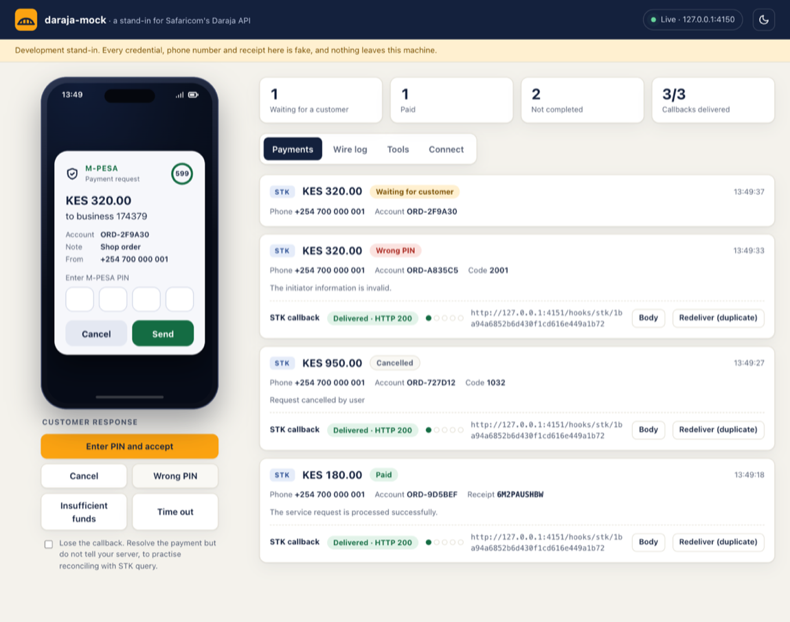

# Case study: daraja-php

*Rules written down first. Tested, then shipped. A record of every change.*

## The problem

I work on the systems behind the money. In Kenya that usually means M-Pesa, and for a PHP developer that
means Daraja. The same story repeats. A cURL snippet is copied from a blog post. It fetches a new OAuth token
on every call. The timestamp and password are built by hand. The callback endpoint decodes whatever JSON
arrives and marks an order paid. Nobody can test it without sandbox credentials and a public HTTPS URL, so it is
tested in production, with real customers.

The failure that hurts most is the quiet one. Callbacks can arrive more than once, late, or never. A handler
that credits on every delivery credits twice. A handler that only listens for callbacks never learns about the
one that was lost. Nobody sees either until reconciliation, or until a customer rings.

## Goals and non-goals

**Goals.** A small, typed client that makes the right thing the easy thing. Callback handling that is safe by
default. A way to develop the whole flow offline, including the awkward cases (cancel, wrong PIN, duplicate, lost).

**Non-goals.** Not a framework package, no service container, no queue. Not a wrapper for every Daraja product.
Not a replacement for reconciling against your Safaricom statements. And not tested against the live API, which
I could not do from this machine (see Status).

## What I built

A PHP 8.3 library with five services (STK Push, C2B, B2C, Transaction Status, Reversal), typed callback parsing,
and a safety layer. Next to it, `bin/daraja-mock`: a PHP built-in server that speaks the same routes and JSON
shapes, plus a web console with a simulated phone.

The console is the part I am proudest of. When your app sends an STK push, the prompt appears on the "phone".
You press Accept, Cancel, Wrong PIN, Insufficient funds or Time out, and the mock POSTs the matching callback
to your callback URL. If your endpoint fails, it retries. A **Redeliver** button sends the same callback again.
A checkbox withholds the callback so you can practise the reconciliation path.

## Design decisions and trade-offs

**1. Idempotency with two locks, not one.** The obvious fix for double-credit is a store of seen callback ids.
I built that: `begin` / `complete` / `release`, with in-memory and PDO implementations, and a lock that expires
so a crashed worker does not block a payment forever. But the store and your ledger are two writes. If the
process dies between "ledger updated" and "key completed", the retry runs the handler again. So the example
also puts a `UNIQUE` constraint on the M-Pesa receipt in the orders table. The store makes duplicates cheap and
quiet. The constraint makes them impossible. The alternative, a single transaction that claims the key and
writes the ledger together, is stronger but only works when both live in one database. It is on the roadmap
as an opt-in mode rather than the only mode.

**2. A mock server instead of a mocked HTTP client.** A fake PSR-18 client proves my code builds the request I
think it builds. It cannot tell me the request is right, because the fake agrees with whatever I told it.
A real server forces the whole path to be honest: cURL, headers, JSON encoding, the OAuth round trip, the
callback delivery, even the float in `"Value": 1.0`. It found a real bug: my JSON encoder printed `1500.0`
as `1500`, so the mock was not exercising the float path that real callbacks take. The mock also has a
state machine of its own, which a stubbed client never has: prompts that time out, callbacks that retry.
The cost is more code to maintain, and a mock only knows what I know about Daraja. That is why the README
says what is unverified.

**3. Token caching without a lock.** Fetching a token per request wastes Daraja calls and can hit rate limits.
PSR-16 has no atomic "add", so a portable cross-process lock is impossible. I used memoisation inside the
process, a cache TTL shortened by a safety margin, and probabilistic early refresh (each caller has a small,
growing chance of refreshing as expiry nears) so workers do not all refresh in the same second. It is not
perfect, only good enough, and it needs no infrastructure. A 401 drops the token and repeats the call once.

**4. Never retry a payment request.** The client retries exactly one thing: a request rejected with 401, after a
token refresh. A timeout on a STK push leaves you not knowing whether the prompt reached the phone. Replaying
it can prompt the customer twice. That decision belongs to the caller, who has the order and the STK query to
find out what happened.

**5. Validate hard, fail with Daraja's own words.** Phone numbers are normalised from four formats or
rejected. Amounts are whole shillings, held as integer cents. A "successful" callback with no receipt number
is refused by the parser, not trusted. Errors keep Daraja's `errorCode`, `errorMessage` and `requestId`
verbatim on the exception, because that is what you paste into a support ticket.

**6. Make uncertain things configurable, not guessed.** I could not check Safaricom's current limits on
AccountReference and TransactionDesc, so they are config values. The Reversal identifier type is a parameter.
The IP allow-list ships empty: a hard-coded list that goes stale either blocks real payments or gives false
comfort, so you supply the addresses.

## How it is kept correct and safe

- **Tests.** 279 PHPUnit cases (267 unit, 12 integration), PHPStan at level max, PSR-12 style checks, on PHP 8.3
  and 8.4 in CI. The integration suite starts the real mock and a receiver on localhost and runs the STK flow
  through the library's own cURL client: accept, cancel, wrong PIN, insufficient funds, timeout, retries until the
  receiver recovers, a duplicate delivery credited once, and a lost callback reconciled with a query.
- **Failure modes covered.** Duplicate and concurrent deliveries, handler crash (the key is released), crash
  with a stale lock (it expires), wrong amount, wrong payer, unknown CheckoutRequestID, malformed or oversized
  bodies (rejected before any key is claimed), expired and revoked tokens.
- **Money.** Integer cents, no floats in comparisons. The cross-check refuses a payment whose amount differs
  from the order, before the handler runs.
- **Secrets.** Config hides secrets from `var_dump`/`print_r`. Logs carry method, path, status and timing, never
  headers or bodies, and a test checks the token, key, secret and phone number never reach the logger.
- **The mock itself.** Loopback only by default, a Host and Origin check on the console API, JSON-only POSTs,
  a strict content security policy, and no external scripts or fonts.

## What I'd do differently, and what's next

I would start from recorded sandbox traffic rather than the documentation. Every fixture here is shaped after
the public docs, and the first thing I would do with sandbox access is replace them. I would also build the
transactional idempotency mode earlier: it is the real answer when ledger and store share a database. Next
steps: that mode, a Laravel package that is run in CI instead of copy-in snippets, and a test that replays
real recorded callbacks against the parser.

## Status

Portfolio build. It runs locally against its own mock with synthetic data; there are no users and no
deployments. **Unverified against live Daraja:** every request and response shape beyond what the
documentation shows, the exact error codes, the full result-code list, the C2B URL rules, B2C versions, the
Reversal identifier, how `SecurityCredential` works with Safaricom's real certificate, and how often and for
how long Safaricom retries callbacks. The `500.001.1001` "still processing" query error is taken from developer
reports. The Laravel files were only syntax-checked. See [GOING-LIVE.md](GOING-LIVE.md) before pointing this
at real money.
